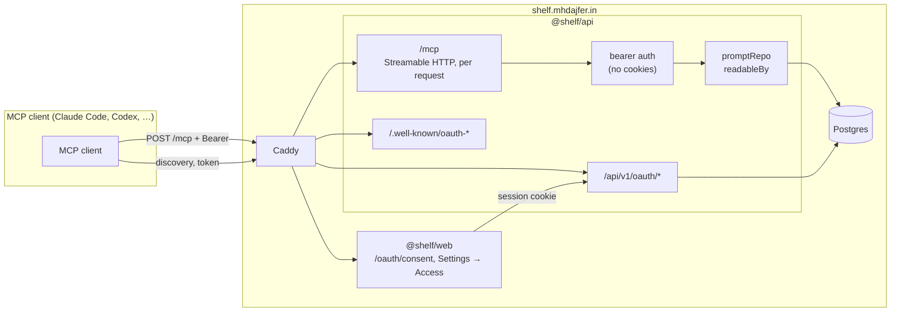
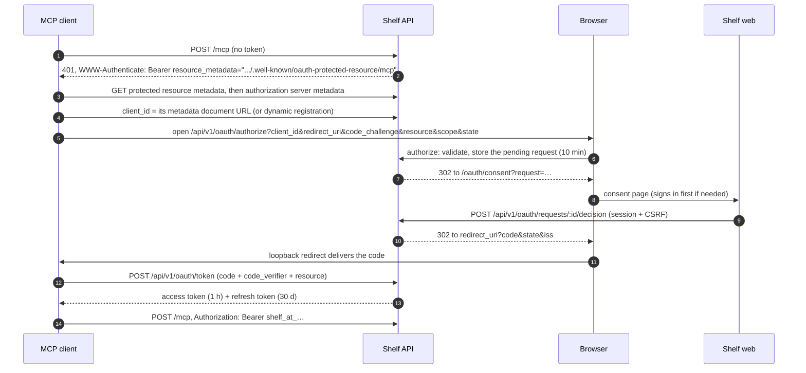

# 0001 — An MCP server for Shelf

| | |
| --- | --- |
| Status | Accepted. Phases 0–2 implemented; phases 3 and 4 pending |
| Author | Muhammed Ajfer |
| Created | 2026-10-14 |
| Revised | 2026-10-15: retargeted at protocol revision 2026-07-28 and SDK v2; see [Revision notes](#revision-notes) |
| Affects | `apps/api`, `apps/web`, `packages/db`, `packages/shared`, `deploy/Caddyfile` |

## Summary

Expose a user's shelf over the [Model Context Protocol](https://modelcontextprotocol.io) so the
prompts they keep in Shelf can be used directly inside Claude Code, Codex CLI, Gemini CLI, Cursor,
VS Code, and any other MCP client. Saved prompts appear as **MCP prompts**, which Claude Code shows
as slash commands (`/mcp__shelf__commit-message`), with each `{{variable}}` as an argument. A small
set of **MCP tools** lets the client's model search the shelf, fetch and render a prompt, and save
new prompts or versions.

The server is a remote Streamable HTTP endpoint at `https://shelf.mhdajfer.in/mcp`, served by the
existing API process so every read goes through the same `readableBy` filter as the REST API. It is
authorised by personal access tokens first and by OAuth 2.1 (the MCP authorization spec) after that,
so connecting becomes one command plus a browser consent screen.

## Motivation

- Prompts are written in Shelf and used somewhere else, almost always in a chat window or a coding
  agent. Today that means opening the site, filling in variables, and copying the result. MCP removes
  the copy step: the prompt is a command in the tool where it is used.
- The README already justifies a separate Express API with "a second consumer: a CLI or browser
  extension can use the same REST surface". This is that consumer, built on an open standard instead
  of a bespoke CLI.
- Shelf's model maps onto MCP almost one to one. A prompt with `{{variables}}` is exactly an MCP
  prompt with arguments; `parseTemplate` already produces the argument list.

## Goals

1. A signed-in user can connect an MCP client to their shelf and use any of their prompts as a
   slash command with arguments, without leaving the client.
2. The client's model can find, read, and render prompts from the user's shelf and the public
   library, and save new prompts and versions to the user's shelf.
3. Connecting follows the MCP authorization spec, so standard clients connect with no
   Shelf-specific code: `claude mcp add --transport http shelf https://shelf.mhdajfer.in/mcp`.
4. The user decides **which** prompts a connection can see (everything, pinned only, or one
   collection) and can revoke any connection from Settings.
5. No new path to private data. A private prompt is as invisible over MCP as it is over REST, and
   this is asserted by tests.

## Non-goals

- **Running prompts on Shelf's model through MCP.** The client is already an LLM; a `run_prompt`
  tool would spend credits to call a second model. Revisit if users ask for model comparison from
  the CLI.
- **Publishing, voting, forking, reporting, or deleting** through MCP. A model acting on its own
  should not be able to publish or destroy anything. Everything saved over MCP is private.
- **Guest access.** MCP requires an account.
- **Change notifications** (`subscriptions/listen` with `promptsListChanged`). The 2026-07-28
  revision makes these possible without sessions, but the SDK's event bus broadcasts every event to
  every open stream, and Shelf's events are per user. Doing it properly needs a per-principal bus;
  see [Alternatives](#alternatives-considered).
- **Multi round-trip requests, sampling, roots, logging.** Nothing here needs input from the client
  mid-request, and sampling, roots and logging are deprecated as of 2026-07-28.
- **A local stdio package.** Every major client supports remote HTTP servers; clients that do not
  can use a generic bridge such as `mcp-remote`.

## User experience

### Connecting Claude Code

Phase 1 (personal access token):

```bash
# Settings → Access → New token, then:
claude mcp add --transport http --scope user shelf https://shelf.mhdajfer.in/mcp \
  --header "Authorization: Bearer shelf_pat_…"
```

Phase 3 onwards (OAuth, no token to copy):

```bash
claude mcp add --transport http --scope user shelf https://shelf.mhdajfer.in/mcp
# then, inside Claude Code: /mcp → shelf → Authenticate
# a browser opens Shelf's consent page; approve, and the client is connected
```

`--scope user` makes the server available in every project. A team can instead commit a project
`.mcp.json` that reads the token from the environment:

```json
{
  "mcpServers": {
    "shelf": {
      "type": "http",
      "url": "https://shelf.mhdajfer.in/mcp",
      "headers": { "Authorization": "Bearer ${SHELF_TOKEN}" }
    }
  }
}
```

### Using it

```text
> /mcp__shelf__commit-message
  (Claude Code asks for the prompt's arguments in order: diff, style)

> Find my prompt for reviewing pull requests and use it on the current branch.
  (the model calls search_prompts, then render_prompt, then follows the result)

> Save the instructions I just gave you as a prompt called "Release notes".
  (the model calls create_prompt; the prompt lands on the user's shelf, private)
```

Each prompt page in the web app shows the command name to its owner ("Use in Claude Code:
`/mcp__shelf__commit-message`") with a copy button.

### Other clients

Every client below speaks remote Streamable HTTP. The exact configuration keys change between
releases, so the in-app setup page ([Phase 4](#phase-4--distribution-and-docs)) is checked against
each client's current documentation when it is written.

| Client | Where it is configured |
| --- | --- |
| Claude Code | `claude mcp add --transport http …`, or `.mcp.json` |
| Codex CLI | `~/.codex/config.toml`, `[mcp_servers.shelf]` with `url` and a bearer token variable |
| Gemini CLI | `settings.json`, `mcpServers.shelf.httpUrl` and `headers` |
| Cursor | `.cursor/mcp.json`, `url` and `headers` |
| VS Code | `.vscode/mcp.json`, `servers.shelf` with `"type": "http"` |

## Architecture



### Where it lives

A new module, `apps/api/src/mcp/`, mounted by `createApp` beside the REST routers:

```
apps/api/src/mcp/
  router.ts        Express router: bearer auth, rate limit, createMcpHandler via toNodeHandler
  auth.ts          bearer middleware: token → grant → user actor + scopes
  server.ts        builds an McpServer for one request's grant
  prompts.ts       prompts/list, prompts/get, completion/complete
  tools.ts         search_prompts, get_prompt, render_prompt, list_collections,
                   create_prompt, update_prompt
  resources.ts     shelf://prompts/{id}
  naming.ts        command names
apps/api/src/oauth/                       (Phase 3)
  metadata.ts      protected resource + authorization server metadata
  clients.ts       client ID metadata documents, dynamic registration
  flow.ts          authorize, decision, token, revoke
apps/api/src/routes/
  access.ts        session-authenticated token management (REST)
```

It runs in the API process because that is where the repositories and the privacy filter are. A
separate service would have to either duplicate `readableBy` or call the REST API over the network
and re-implement auth. The module is self-contained, so it can move to its own process later
without changing its interface.

### Protocol choices

- **SDK:** the v2 TypeScript SDK: `@modelcontextprotocol/server` and `@modelcontextprotocol/node`,
  pinned to exact versions, with `@modelcontextprotocol/client` for the tests. The v1 package,
  `@modelcontextprotocol/sdk`, is the maintenance line: it implements revisions up to 2025-11-25,
  will not implement 2026-07-28, and receives fixes for at least six months after 2026-07-27.
- **Protocol revision:** 2026-07-28, which removes protocol sessions and the `initialize`
  handshake: every request carries its protocol version and client capabilities in `_meta`.
  Clients still on a 2025 revision are answered by the SDK's stateless fallback from the same
  server definition, so both eras see the same prompts and tools.
- **Transport:** Streamable HTTP through the SDK's `createMcpHandler(factory)`. The factory builds
  an `McpServer` for the caller's grant on every request; nothing is kept between requests, so
  there is no session store, nothing sticky, and a restart loses nothing. 2025-era `GET` and
  `DELETE` (session operations) answer 405.
- **Per-user prompts:** a user's prompts are data, not code, so `prompts/list`, `prompts/get`, and
  `completion/complete` are request handlers on the underlying `Server`, not one `registerPrompt`
  per prompt (which would load the whole shelf on every tool call). Tools use the high-level
  `registerTool` with Zod input and output schemas.
- **Caching:** list results on 2026-07-28 carry `ttlMs` and `cacheScope`. Every list here is per
  user, so `cacheScope` is `private`; `ttlMs` is 0 because there are no change notifications to
  invalidate a longer lifetime. At the HTTP level every response is `Cache-Control: no-store,
  no-transform`; the SDK's own `no-cache` on event streams would still let a cache keep a copy.
- **Validation:** tool input schemas are built from the same field schemas in `@shelf/shared` that
  the REST routes use, as **strict** objects: a key the tool does not define (`visibility`,
  `turnstileToken`, `pinned`) is an error, not silently dropped.

## Protocol surface

### Which prompts a connection sees: the prompt set

Every grant (a personal access token or a connected app) carries a **prompt set**, chosen when it is
created:

| Prompt set | What `prompts/list` returns | Backed by |
| --- | --- | --- |
| `all` | Every prompt the user owns that is not deleted | `promptRepo.listCommands` |
| `pinned` | Pinned prompts only | `listCommands({ pinnedOnly: true })` |
| `collection` | One collection | `listCommands({ collectionId })` |

The set limits the user's **own** prompts everywhere: `prompts/list`, `prompts/get`, resources, and
the `mine` scope of every tool. An own prompt outside the set is reported exactly as a missing one.
The set is a predicate in the repository query, never a filter applied to results afterwards. The
public library stays readable through the tools, because it is public. Limiting a grant to one
collection also keeps Claude Code's slash-command menu manageable for a large shelf.

### Command names

MCP addresses prompts by name, and Claude Code puts the name in the slash command. Names must be
stable, so they are **stored**, not derived on every request:

- A new column, `prompts.command_name`: lowercase `[a-z0-9-]`, starting with a letter or digit,
  1–48 characters, unique among the owner's live prompts.
- Set when a prompt is created (including forks and imports), by slugifying the title
  (`"Commit message (conventional)"` becomes `commit-message-conventional`). A title that slugifies
  to nothing (an emoji, a non-Latin script) becomes `prompt`. A collision gets `-2`, `-3`, and so
  on, truncating the base so the suffix still fits in 48 characters.
- Concurrent creates cannot see each other's uncommitted rows, so name assignment for one owner is
  serialised with a transaction-scoped advisory lock (the pattern credits already use). The unique
  index stays the final word: the insert runs in a savepoint and retries on a violation, which
  covers a rename racing a create.
- **It does not change when the title changes**, so a renamed prompt keeps its command. The owner
  can edit it in the editor; a taken name answers 409.
- Deleting a prompt frees its name: the unique index covers live prompts only, like the one-fork
  index.
- The migration backfills existing prompts in `created_at` order, so the oldest prompt keeps the
  plain name.
- Guest prompts have no owner and get no command name.

### Prompts

**`prompts/list`** returns the grant's prompt set in command-name order, paged with an opaque
`cursor` that encodes the last name returned, 50 per page (`MAX_PAGE_SIZE`). Ordering by name
rather than by update time keeps pages stable while the user edits, gives the deterministic order
the spec asks list results to have, and matches how a client's slash-command menu sorts.

Each entry:

```json
{
  "name": "commit-message",
  "title": "Commit message (conventional)",
  "description": "Writes a conventional commit message from a diff.",
  "arguments": [
    { "name": "diff", "required": true },
    { "name": "style", "description": "Optional. Default: concise", "required": false }
  ]
}
```

- Arguments come from the current version's stored `variables`, in order of first appearance. That
  order matters because Claude Code passes slash-command arguments positionally.
- A variable with a default is optional and its description shows the default; one without a
  default is required.
- An argument sent as an empty string counts as not supplied, so the default applies. Clients send
  one for an argument the user skipped.

**`prompts/get`** renders the current version with `renderTemplate` from `@shelf/shared`, so
rendering cannot differ from the web preview or a test run. It returns one `user` message with the
rendered text. A missing required argument answers JSON-RPC `-32602` (invalid params) and names the
missing variables (from `missingVariables`). An unknown name, or a prompt outside the prompt set,
answers the same `-32602` with the same message.

**`completion/complete`** for a prompt argument offers the variable's default when it has one, so a
client's argument field is prefilled the way the web's fill-in panel is.

### Tools

| Tool | Scope | Annotations | What it does |
| --- | --- | --- | --- |
| `search_prompts` | `prompts:read` | read-only | Full-text search over `mine` (the prompt set) or `public`, with optional tag and limit (≤ 25). Returns **metadata only**: id, command name, title, description, tags, variables, author, URL. |
| `get_prompt` | `prompts:read` | read-only | One prompt by id or command name, with its body, variables, and version (current, or a given number). |
| `render_prompt` | `prompts:read` | read-only | Renders a prompt with given arguments and returns the text. For clients that use tools but not the prompts primitive. |
| `list_collections` | `prompts:read` | read-only | The user's collections, with prompt counts. Empty for a grant limited to pinned prompts; only its own collection for a collection grant. |
| `create_prompt` | `prompts:write` | not read-only, not destructive | Saves a new prompt to the user's shelf. **Always private.** Kept inside the grant's prompt set (pinned, or added to its collection), so the model can go on to use it. |
| `update_prompt` | `prompts:write` | not read-only, not destructive, idempotent | Edits an owned prompt in the prompt set. A changed body appends a version, with an optional note, exactly as `PATCH /prompts/:id` does; an unchanged body is a metadata edit. Never changes visibility. |

- Every tool declares an `outputSchema` and returns `structuredContent` plus a text rendering of the
  same data, for clients that only read text.
- Errors a model can act on (missing variables, validation failures, "no prompt with that name")
  return `isError: true` with a plain message, so the model can correct itself. Auth and scope
  failures are HTTP errors.
- Writes reuse the existing repository calls (`promptRepo.create`, `addVersion`, `updateMeta`), the
  `write` rate limit, and the `maxPromptsPerUser` cap. The profanity check and the
  email-verification rule do not apply: on the web they guard **publishing**, and nothing saved
  over MCP is public.
- `get_prompt` and `render_prompt` on a public prompt by someone else say so in the result
  (`author`, `ownedByYou: false`), so the model can treat it as third-party text.

### Resources

A resource template, `shelf://prompts/{id}`, returns the same Markdown as
`GET /prompts/:id/export`. `resources/list` returns the prompt set. This lets users attach a prompt
as context (`@shelf:shelf://prompts/…` in Claude Code) instead of running it. Reading a prompt
outside the set, or someone else's, answers `-32602` like an unknown URI.

## Authorization

The MCP endpoint accepts **bearer tokens only**. It never reads the session cookie: it is mounted
before the `identity` middleware, and requests carrying only a cookie get 401. That is what makes
exempting `/mcp` from CSRF safe: a browser cannot attach a bearer token to a cross-site request.

Both kinds of credential resolve to one record, a **grant**: a user, a set of scopes, a prompt set,
and how it was issued. The MCP handler sees `{ actor, scopes, promptSet, grantId }` and does not
know which kind it came from. The actor is always `userActor(userId, 'user')`, **whatever the
user's role**: a token never carries admin reach, so an admin's token cannot read prompts that
moderation has hidden.

### Scopes

| Scope | Allows |
| --- | --- |
| `prompts:read` | `prompts/*`, `resources/*`, `completion/complete`, and the read-only tools |
| `prompts:write` | `create_prompt`, `update_prompt`. Always granted together with `prompts:read` |

A personal access token without `prompts:write` is not offered the write tools at all: there is no
way to widen a token, so listing tools it can never call would only mislead the model. Each write
tool also carries the SDK's per-tool `scopeChallenge`, which answers HTTP 403 with
`WWW-Authenticate: Bearer error="insufficient_scope", scope="prompts:read prompts:write"`. Phase 3
lists the write tools to OAuth grants without the scope, so that challenge lets a client ask the
user to widen the grant.

### Phase 1: personal access tokens

- Created in **Settings → Access**: a name, scopes, prompt set, and expiry (30, 90, or 365 days;
  90 by default; never "no expiry"). At most 20 live tokens per user.
- Format `shelf_pat_` followed by 32 random bytes in base64url. The prefix makes tokens easy to
  recognise in logs and leaked files, and lets them be registered with secret scanning later.
- **Shown once.** The database stores the SHA-256 of the token, as it already does for sessions and
  emailed tokens, plus the prefix and first 6 characters after it for display.
- A token is checked on every request: unknown, expired, or revoked answers 401 with
  `WWW-Authenticate: Bearer error="invalid_token"`.
- `last_used_at` is written at most once every 5 minutes per grant, so a busy client does not cause
  a write on every call.

### Phase 3: OAuth 2.1, per the MCP authorization spec

Shelf is both the **resource server** (`/mcp`) and the **authorization server**, because it already
owns the user's identity. The v2 SDK provides the resource-server half (protected resource
metadata, bearer challenges); the authorization server is written here, with the consent page in
Next.js.



Endpoints:

| Endpoint | Auth | Purpose |
| --- | --- | --- |
| `GET /.well-known/oauth-protected-resource/mcp` | none | RFC 9728 metadata: the resource and its authorization server |
| `GET /.well-known/oauth-authorization-server` | none | RFC 8414 metadata: endpoints, `S256`, scopes, `client_id_metadata_document_supported`, `authorization_response_iss_parameter_supported` |
| `POST /api/v1/oauth/register` | none, rate limited | RFC 7591 dynamic client registration, for older clients only |
| `GET /api/v1/oauth/authorize` | none | Validates the request and sends the browser to the consent page |
| `GET /api/v1/oauth/requests/:id` | session | What the consent page shows |
| `POST /api/v1/oauth/requests/:id/decision` | session + CSRF | Approve (with a prompt set) or deny |
| `POST /api/v1/oauth/token` | client + PKCE | `authorization_code` and `refresh_token` grants |
| `POST /api/v1/oauth/revoke` | client | RFC 7009 revocation |

Rules, each with a test:

- **PKCE with `S256` is required.** `plain` is refused.
- **Redirect URIs match exactly**, except loopback URIs (`http://127.0.0.1` and `http://localhost`),
  where any port is accepted, as RFC 8252 specifies for native apps. Plain `http` is refused for any
  other host.
- **The authorization response carries `iss`** (RFC 9207), which 2026-07-28 clients validate
  before redeeming the code.
- **Authorization codes** live 60 seconds and are consumed in one `UPDATE … RETURNING`, the pattern
  the emailed tokens already use. A second use of a code revokes every token issued from it.
- **Tokens are bound to the resource** (RFC 8707). The token request must name
  `https://shelf.mhdajfer.in/mcp`, and `/mcp` rejects a token issued for anything else. Shelf never
  passes a client's token on to another service.
- **Refresh tokens rotate.** Each use returns a new refresh token and consumes the old one. Using a
  consumed refresh token revokes its whole family, which is the signal that it was stolen.
- **Opaque tokens, not JWTs.** One indexed lookup per request is cheap, and revocation takes effect
  on the next call, the same trade-off sessions already make.
- **Client registration: metadata documents first.** 2026-07-28 deprecates dynamic registration in
  favour of client ID metadata documents (a client whose `client_id` is an HTTPS URL to its
  metadata). Shelf supports both, because clients on older revisions only do dynamic registration.
  Fetching a metadata document is an outbound request to a URL a stranger chose, so it is
  HTTPS-only, refuses private and loopback addresses after DNS resolution, has a 5-second timeout and
  a 64 kB cap, and is cached.
- **Unused registrations expire.** A dynamically registered client with no grant after 30 days is
  deleted by the scheduler.

The consent page (`apps/web/src/app/oauth/consent/page.tsx`) shows the client's self-declared name
**marked as unverified**, where it will redirect ("an app on this computer" for loopback), the
scopes in plain words, and a prompt-set selector. Approving creates or updates the user's grant for
that client.

### Revocation and account events

| Event | Personal access tokens | Connected apps |
| --- | --- | --- |
| Revoked in Settings → Access | That token | That app's grant and all its tokens |
| Password **reset** (via emailed link) | All revoked | All revoked |
| Google sign-in claims an **unverified** account | All revoked | All revoked |
| Password **change** (signed in) | Kept; Settings lists them | Kept |
| The grant's collection is deleted | That grant is deleted | That grant is deleted |
| Account deleted | Cascade | Cascade |

A reset is treated as a possible compromise, as it already is for sessions, and so is a Google
sign-in that takes over an account whose address was never proven: the existing code already drops
that account's password and sessions. A change made by a signed-in user is not. Deleting a
collection deletes grants scoped to it rather than quietly widening them to the whole shelf;
Settings → Access names the collection each token is limited to.

## Data model

Migration `0005_mcp_access.sql` (Phase 1) adds command names and the grant and token tables, with
Drizzle definitions in `packages/db/src/schema/access.ts`. The OAuth tables (`oauth_clients`,
`oauth_codes`, and `access_grants.client_id`) arrive with Phase 3 in their own migration.

```sql
ALTER TABLE prompts ADD COLUMN command_name text;
-- backfill, then:
CREATE UNIQUE INDEX prompts_owner_command_name_key
  ON prompts (owner_id, command_name)
  WHERE owner_id IS NOT NULL AND status <> 'deleted';
ALTER TABLE prompts ADD CONSTRAINT prompts_command_name_check
  CHECK ((owner_id IS NULL) = (command_name IS NULL));
ALTER TABLE prompts ADD CONSTRAINT prompts_command_name_format_check
  CHECK (command_name ~ '^[a-z0-9][a-z0-9-]{0,47}$');

CREATE TYPE grant_kind AS ENUM ('token', 'app');
CREATE TYPE prompt_set AS ENUM ('all', 'pinned', 'collection');
CREATE TYPE access_token_kind AS ENUM ('pat', 'access', 'refresh');

CREATE TABLE access_grants (
  id            uuid PRIMARY KEY DEFAULT gen_random_uuid(),
  user_id       uuid NOT NULL REFERENCES users(id) ON DELETE CASCADE,
  kind          grant_kind NOT NULL,
  name          text NOT NULL,             -- token name, or the client's name at consent
  scopes        text[] NOT NULL,
  prompt_set    prompt_set NOT NULL DEFAULT 'all',
  -- CASCADE, not SET NULL: deleting the collection must not quietly widen
  -- the grant to the whole shelf.
  collection_id uuid REFERENCES collections(id) ON DELETE CASCADE,
  last_used_at  timestamptz,
  created_at    timestamptz NOT NULL DEFAULT now(),
  CHECK ((prompt_set = 'collection') = (collection_id IS NOT NULL)),
  CHECK (scopes <@ ARRAY['prompts:read', 'prompts:write'] AND 'prompts:read' = ANY (scopes))
);
CREATE INDEX access_grants_user_idx ON access_grants (user_id, created_at DESC);
CREATE INDEX access_grants_collection_idx ON access_grants (collection_id);

CREATE TABLE access_tokens (
  id           uuid PRIMARY KEY DEFAULT gen_random_uuid(),
  grant_id     uuid NOT NULL REFERENCES access_grants(id) ON DELETE CASCADE,
  kind         access_token_kind NOT NULL,
  token_hash   text NOT NULL,              -- SHA-256, like sessions.id
  display      text NOT NULL,              -- e.g. "shelf_pat_3fK9a1…"
  family_id    uuid,                       -- refresh rotation (Phase 3)
  resource     text,                       -- RFC 8707 audience (Phase 3)
  expires_at   timestamptz NOT NULL,
  consumed_at  timestamptz,                -- refresh tokens, once rotated (Phase 3)
  created_at   timestamptz NOT NULL DEFAULT now()
);
CREATE UNIQUE INDEX access_tokens_hash_key ON access_tokens (token_hash);
CREATE INDEX access_tokens_grant_idx ON access_tokens (grant_id);
CREATE INDEX access_tokens_expires_idx ON access_tokens (expires_at);
```

A grant's expiry is its token's: a personal access token's grant is deleted with the token, and an
app's grant lives as long as it has an unexpired refresh token. Revoking is a delete of the grant
row; the cascade removes its tokens. Expired tokens, and the grants left with no token, are deleted
by the scheduler beside the existing session cleanup.

A new repository, `accessRepo`, owns these tables, and `@shelf/db` keeps them behind
`@shelf/db/schema` like the rest, so routes cannot query them directly.

## Changes to existing code

| File | Change |
| --- | --- |
| `apps/api/src/app.ts` | Mount `/mcp` after `cors` (which already refuses unlisted origins) and **before** `identity` and `csrfProtection`; the MCP router sets `Cache-Control: no-store` itself. Mount `routes/access.ts` with the other session routes |
| `apps/api/src/security/rateLimit.ts` | New bucket: `mcp` (120/min per grant). Phase 3 adds `oauthRegister` and `oauthToken` |
| `apps/api/src/routes/auth.ts` | Password reset, and Google sign-in over an unverified account, delete the user's grants |
| `apps/api/src/jobs/scheduler.ts` | Delete expired tokens and empty grants |
| `apps/api/src/docs/openapi.ts` | Document `routes/access.ts`; `openapi.test.ts` already fails if it is missing. `/mcp` is JSON-RPC, not REST, so it is documented on the setup page instead |
| `packages/db/src/repositories/promptRepo.ts` | `create` assigns a command name; `listCommands`, `findOwnedByCommandName`, `renameCommand`; command name in `PromptSummary` |
| `packages/shared/src/schemas/` | `commandNameSchema`, `slugifyCommandName`, token DTOs and the create-token schema |
| `apps/web/src/components/settings.tsx` | An **Access** section: create, list, and revoke tokens |
| `apps/web` | Command name in the editor and on the prompt page |
| `deploy/Caddyfile` | Route `/mcp` (and, with Phase 3, `/.well-known/oauth-*`) to the API |

The Caddy change:

```caddyfile
handle /mcp {
	reverse_proxy api:4000
}
```

## Security and privacy

| Threat | Defence | Test |
| --- | --- | --- |
| Reading another user's private prompt over MCP | All reads go through `readableBy`; own-prompt lookups go through owner-keyed queries with the grant's user | `privacy.mcp.spec.ts`: every tool, `prompts/get`, and `resources/read` against another user's private prompt, with the error compared to the one for a prompt that never existed |
| Escaping the prompt set | The set is applied in the repository query, not filtered afterwards | Fetching an own prompt outside the set by id and by name looks exactly like a missing one |
| An admin's token reaching hidden prompts | MCP actors always have the `user` role | An admin token cannot `get_prompt` a hidden public prompt |
| CSRF against `/mcp` | Bearer-only; cookies ignored | A cookie-only request gets 401 |
| DNS rebinding and browser abuse | `/mcp` sits behind the existing `cors` check, which refuses any `Origin` not on the allowlist; CLI clients send none | An unlisted `Origin` gets 403 |
| Token theft from the database | SHA-256 hashes only | `schema.spec.ts`: the token hash column is unique and the raw token is never stored |
| Escalating a read-only token | Write tools carry a scope challenge | A read-only token calling `create_prompt` gets 403 `insufficient_scope` |
| Stolen refresh token (Phase 3) | Rotation and family revocation | Reusing a rotated token revokes the family |
| Authorization code interception (Phase 3) | PKCE `S256`, exact redirect match, single use, `iss` | Wrong verifier, wrong redirect, and replay are each refused |
| Token used against another service (Phase 3) | Resource binding (RFC 8707) | A token for another resource gets 401 |
| SSRF through client metadata documents (Phase 3) | HTTPS only, private addresses refused after DNS resolution, timeout and size cap | Loopback, link-local, and private-range URLs are refused |
| Prompt injection through public prompts | `search_prompts` returns metadata, not bodies; `get_prompt` labels the author and marks public content as written by someone else; MCP writes are always private and cannot delete | `create_prompt` with `visibility: "public"` in the arguments is refused by the strict schema |
| A runaway agent | `mcp` and `write` rate limits; writes are not destructive | Rate limit test |
| Tokens in logs | The request logger logs only method, URL, and status, and Pino already redacts `req.headers.authorization` | Review |

SECURITY.md gets a new **MCP and API tokens** section in the same format as the existing ones.

## Testing

- **Unit (Vitest):** command-name slugify, truncation, and collision suffixes; variables to
  arguments, including order and required flags; cursor encoding; token format and parsing.
- **Integration (real Postgres):** drive the server with the SDK's own `Client` over
  `StreamableHTTPClientTransport`, against the API listening on an ephemeral port in the existing
  test harness. Covers list and get, completions, resources, every tool, scope and prompt-set
  enforcement, revoked and expired tokens, the access routes, and the privacy suite above. A raw
  2025-era request checks the stateless fallback.
- **Schema (`schema.spec.ts`):** the new checks and the cascades, especially that deleting a
  collection deletes grants scoped to it, and that a deleted prompt frees its command name.
- **End to end (Playwright):** create a token and see it exactly once; revoke it; an axe scan of
  Settings → Access in both colour schemes.
- **Against real clients, before each release:** the MCP Inspector, Claude Code, and at least one
  other client from the table above, following a written checklist.

## Observability

Each MCP request logs the JSON-RPC method, the tool or prompt name, the grant id, latency, and the
outcome. Never arguments, rendered text, or tokens. Settings → Access shows each grant's last use.

## Rollout

### Phase 0 — Spike (½–1 day)

Add the v2 SDK, check it works with Zod 4 and Express 5, serve one hard-coded tool through
`createMcpHandler`, and call it with the SDK client on both protocol eras.

**Done when:** a 2026-07-28 client and a 2025-11-25 client both list and call the test tool.

### Phase 1 — Read-only MCP with personal access tokens (3–4 days)

Migration (command names, grants, tokens, but not the OAuth tables yet), `accessRepo`,
`routes/access.ts`, Settings → Access for tokens, `/mcp` with prompts and the read-only tools, the
Caddy route, and the tests for all of it.

**Done when:** a user creates a token, connects Claude Code with one command, runs a stored prompt
as a slash command with arguments, and the privacy suite passes over MCP.

### Phase 2 — Writes, resources, completions (2 days)

`create_prompt`, `update_prompt`, the `prompts:write` scope, the `shelf://` resources, and argument
completion.

**Done when:** a model saves a new prompt and a new version from Claude Code, both private, and the
version appears in the web history with its note.

### Phase 3 — OAuth 2.1 (5–7 days)

The OAuth tables, metadata, registration (metadata documents and dynamic), authorize, the consent
page, token, refresh rotation, revocation, connected apps in Settings, and revocation on password
reset.

**Done when:** `claude mcp add --transport http shelf https://shelf.mhdajfer.in/mcp` followed by
`/mcp → Authenticate` connects with no token copied, and every rule in
[Phase 3: OAuth 2.1](#phase-3-oauth-21-per-the-mcp-authorization-spec) has a passing test.

### Phase 4 — Distribution and docs (1–2 days)

`/docs/mcp` in the web app with one tab per client; a README section and a short demo recording;
SECURITY.md updated; a listing in the official MCP Registry.

**Done when:** a new user goes from the setup page to running a prompt in their client without
reading anything else.

Each phase ships on its own and leaves the app working. Phase 1 is useful without the rest.

## Alternatives considered

- **A separate `apps/mcp` service.** It would need direct database access, duplicating the privacy
  filter, or a REST hop with its own auth. Rejected for now; the module boundary keeps the option
  open.
- **A local stdio package (`npx @shelf/mcp`) calling the REST API.** It has simpler auth (a token in
  an environment variable) but must be installed, needs Node on the user's machine, cannot be used
  by web-based clients, and needs releasing for every change. Remote HTTP is the standard for a
  hosted service.
- **Session cookies on `/mcp`.** CLI clients have no browser cookie jar, and accepting cookies on a
  CSRF-exempt endpoint would create exactly the hole the CSRF token exists to close.
- **The v1 SDK (`@modelcontextprotocol/sdk`).** It is the maintenance line and will not implement
  2026-07-28. Starting a new server on it means a migration within months.
- **Change notifications through `subscriptions/listen`.** 2026-07-28 replaced the session-bound
  `GET` stream with `subscriptions/listen`, so `notifications/prompts/list_changed` no longer needs
  sessions. It does need the event to reach only the right user's streams; the SDK's default bus
  broadcasts to every stream on the handler. Revisit with a bus keyed by user (Redis pub/sub,
  which the API already has) if clients come to rely on it. Clients refresh the list on reconnect,
  which is enough for v1.
- **Registering one MCP prompt per Shelf prompt in the factory.** Simple, but it would load the
  whole prompt set on every request, including every tool call. Request handlers for
  `prompts/list` and `prompts/get` query only what each request needs.
- **JWT access tokens.** They avoid a lookup per request but cannot be revoked before they expire.
  Shelf already chose opaque tokens for sessions for the same reason.

## Open questions

1. Should the public library be readable over MCP **without** an account (read-only, rate limited
   by address)? Leaning no for v1: it adds an anonymous surface for little gain.
2. Is 90 days the right default token lifetime for a CLI tool that people set up once?
3. Should prompts the user has **upvoted** (not forked) be offered as an optional prompt set?
4. Once OAuth ships, are personal access tokens still worth offering? Keep them for CI and scripts,
   where there is no browser to consent in.

## Revision notes

The first draft was checked against protocol revision 2025-11-25 and SDK v1. On review:

- **Retargeted at 2026-07-28 and SDK v2.** The newer revision removes sessions and the handshake,
  which turns the draft's stateless design from a trade-off into the protocol's own model, and it
  requires `ttlMs`/`cacheScope` on list results. SDK v1 will not implement it.
- **Command names.** The unique index now covers live prompts only, so deleting a prompt frees its
  name; collisions are resolved by retrying on the index, not by a check before the insert.
- **List order.** By command name with a keyset cursor, instead of pinned-first then recently
  updated, which shifted under offset paging whenever a prompt was edited.
- **Write rules.** The draft applied the profanity check and email verification to MCP writes; both
  guard publishing on the web, and MCP never publishes.
- **Admin reach.** MCP actors always have the `user` role.
- **Revocation.** Added the Google sign-in takeover of an unverified account, which already drops
  passwords and sessions.
- **Client registration.** Dynamic registration is deprecated in 2026-07-28 in favour of client ID
  metadata documents, and authorization responses now carry `iss` (RFC 9207).
- **Strict tool schemas.** A non-strict Zod object drops unknown keys, so `visibility: "public"`
  would have been silently ignored rather than refused.

## What this demonstrates

For a reviewer reading this alongside the code: implementing an open protocol from its
specification; a standards-based OAuth 2.1 authorization server (PKCE, RFC 8414, 9728, 7591, 8707,
7009, 9207, refresh rotation); extending an existing access-control model without adding a path
around it; and threat modelling that ends in tests, not just prose.
